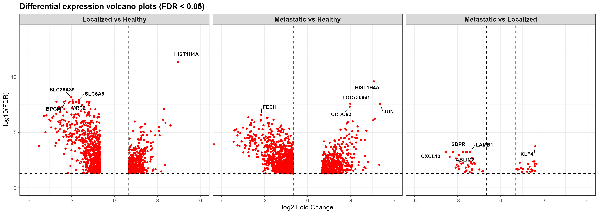
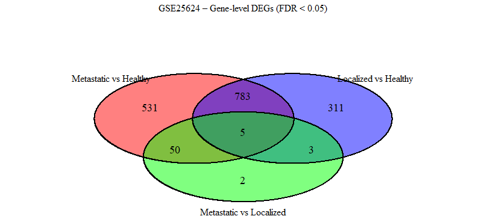

# Neuroblastoma Bone Marrow Transcriptomics: DEGs, Enrichment & Hub Genes

This project analyses differential expression in **bone marrow from neuroblastoma (NB) patients**, using GEO [GSE25624](https://www.ncbi.nlm.nih.gov/geo/query/acc.cgi?acc=GSE25624) (Agilent GPL4133). Three groups are compared:

| Code | Group | n |
|---|---|---|
| **I** | Metastatic NB: bone marrow infiltrated by tumour | 9 |
| **NI** | Localized NB: non-infiltrated bone marrow | 23 |
| **H** | Healthy young donors | 8 |

The workflow runs in five steps:
1. **Differential expression**: GEOquery, then log2 transformation if needed and quantile normalisation, then **limma** (cell-means model, three contrasts, eBayes). Probes are collapsed to genes by keeping the most significant probe per gene. A gene counts as a DEG at **FDR < 0.05 and |log2FC| ≥ 1**.
2. **Venn analysis**: overlaps between the three DEG sets, giving core and unique gene sets.
3. **Enrichment**: [PANTHER](https://pantherdb.org) GO-Slim overrepresentation (Fisher's exact test, FDR) and [g:Profiler](https://biit.cs.ut.ee/gprofiler) (GO, KEGG, Reactome, CORUM, miRNA).
4. **Network**: a STRING protein–protein interaction network built in Cytoscape, with the top 30 hub genes ranked by degree.
5. **Visualisation**: volcano plots, a Venn diagram and annotated heatmaps.

## Results

### Differential expression

| Contrast | DEGs | Up | Down | Top genes |
|---|---|---|---|---|
| I vs H (metastatic vs healthy) | 1,369 | 538 | 831 | HIST1H4A, JUN, FECH, SNCA, MRC2 |
| NI vs H (localized vs healthy) | 1,102 | 423 | 679 | HIST1H4A, SLC25A39, MRC2, SLC6A8, BPGM |
| **I vs NI (metastatic vs localized)** | **60** | 24 | 36 | KLF4, CXCL12, ABLIM3, LAMB1, CLDN5 |



### Overlaps



| Set | Genes | File |
|---|---|---|
| Core disease (I∩NI vs H) | 788 | `results/venn/CORE_DISEASE.tsv` |
| Core metastasis (I vs NI ∩ I vs H) | 55 | `results/venn/CORE_METASTASIS.tsv` |
| Shared by all three | 5 (LOC730961, TMEM107, RGS6, EIF4E, EBF3) | `results/venn/CORE_ALL.tsv` |
| Unique to I vs H / NI vs H / I vs NI | 531 / 311 / 2 | `results/venn/UNIQUE_*.tsv` |

### Metastatic vs localized: the key contrast

The two NB groups differ mainly in two programmes:

- **Up in infiltrated marrow: an interferon signature.** ISG15, MX1, MX2, OASL, OAS3, IFIT2, IFIT5, IFI44, IRF7, XAF1, HERC5 and CXCL10 are higher, as is KLF4.
- **Down in infiltrated marrow: niche and megakaryocyte/platelet genes.** CXCL12 (log2FC −3.8), VCAM1, ITGB3, PF4, PF4V1, PPBP, GP1BA, TUBB1, CLEC1B, LAMB1, LAMA4 and VEGFC are lower.

These results reproduce the original study's headline finding of an IFN signature together with CXCL12 down-regulation. g:Profiler on this contrast is led by *response to virus* (GO:BP), *CXCR chemokine receptor binding* (GO:MF) and ITGAV–ITGB3 integrin complexes (CORUM).

### Hub genes (STRING, degree, top 30)

| Contrast | Top hubs |
|---|---|
| I vs H | CDK1, CCNB1, CENPA, CCNA2, FN1, TNF, STAT1, CDC20, AURKA, TOP2A, JUN, STAT3, CCND1, IFNG |
| NI vs H | Histone cluster genes (H4C6, H3C12, H2BC21, …), EPB42, ALAS2, JUN, STAT3, HIF1A, GYPA, GYPB, SLC4A1 |

The complete ranked lists are in `network/*/hub_top30_genes.csv`, and the Cytoscape sessions are in `network/*/string_network.cys`.

PANTHER GO-Slim BP enrichment (FDR < 0.05), with full tables in `enrichment/panther/`:
- **Both disease-vs-healthy contrasts:** heme biosynthesis, porphyrin/tetrapyrrole metabolism and the cell cycle are enriched.
- **I vs H only:** sprouting angiogenesis, VEGFR signalling, response to virus, response to ROS and detoxification are also enriched.

## Interpretation and limitations

- **Contrasts against healthy donors are probably confounded by cell composition.** The NI vs H hubs and enrichment are dominated by erythroid genes (ALAS2, GYPA, GYPB, EPB42, SLC4A1), heme biosynthesis and histones. This pattern usually reflects differences in the proportions of erythroid and proliferating cells in the marrow, not tumour biology. The healthy group are young donors and the marrow sampling may differ, so age and procedure are further possible confounders. Treat the I vs H and NI vs H lists as partly compositional.
- **I vs NI is the cleanest comparison** because both groups are NB patients with the same tissue type. It is also the smallest: 60 DEGs from 9 vs 23 samples.
- **Cell-type deconvolution was not performed.** Running CIBERSORTx or xCell, or adding cell-type covariates, would separate composition effects from regulation within cells.
- **Sample sizes are small** (H = 8, I = 9), so effect sizes and DEG counts will be unstable.
- **The STRING hub ranking (degree) favours well-studied, highly connected proteins** such as histones and cell-cycle genes. Hub status is not evidence of a driver role.
- **The volcano plots show DEGs only.** They are drawn from the filtered DEG tables, so non-significant genes are absent. A full volcano plot would use every gene (see the comment in the script).
- **Probe collapsing happens before the fold-change filter.** The most significant probe is kept per gene and the |log2FC| filter is then applied to that probe. A gene can therefore be dropped even if another of its probes passes both cut-offs.
- **There is no external validation cohort.**

## Repository layout

```
├── results/
│   ├── degs/          # gene-level DEG tables per contrast (FDR < 0.05, |log2FC| ≥ 1)
│   └── venn/          # core / unique gene sets
├── figures/
│   ├── volcano/       # 3-panel volcano (PNG, PDF)
│   ├── venn/          # Venn diagram (PNG, PDF)
│   └── heatmaps/      # annotated DEG heatmaps
├── enrichment/
│   ├── panther/       # GO-Slim BP overrepresentation (I vs H, NI vs H)
│   └── gprofiler/     # g:Profiler results for all three contrasts
├── network/           # STRING/Cytoscape sessions, hub-gene tables and plots
├── scripts/           # R analysis (deg_analysis.R) + original script
└── data/              # raw data not tracked (see data/README.md)
```

DEG table columns: `ProbeID, Gene.symbol, log2FC, AveExpr, t, P.Value, adj.P.Val`. Contrasts are written as *first group vs second group*, so a positive log2FC means higher expression in the first group.

## Reproducing

```r
install.packages(c("BiocManager", "dplyr", "ggplot2", "ggrepel", "VennDiagram", "pheatmap"))
BiocManager::install(c("GEOquery", "limma"))
```

```bash
# from the repository root; downloads GSE25624 on first run
Rscript scripts/deg_analysis.R
```

The script regenerates `results/degs/`, `results/venn/` and `figures/`. `scripts/original/sal_GSE25624.R` is the original interactive script, kept for provenance; `scripts/deg_analysis.R` is the same analysis made portable (relative paths, heatmaps saved to file).

The enrichment (PANTHER, g:Profiler) and network (STRING/Cytoscape) steps were run in their web tools and the Cytoscape desktop app, using the DEG gene lists as input. Their exported results are in `enrichment/` and `network/`.

## Reference

Data from GEO GSE25624: *"The bone marrow microenvironment in patients with neuroblastoma: presence of IFN signature and significant down-regulation of CXCL12 expression."*

## License

MIT
